<table align="center">
  <tr>
    <td align="center" bgcolor="#0B1220">
      
    </td>
  </tr>
</table>

<h1 align="center">AlienFish Surface&trade;</h1>

<p align="center">
  A schema-first React design framework for dense, accessible browser and Electron applications.
</p>

<p align="center">
  <a href="https://github.com/alienfish-consulting/surface/actions/workflows/ci.yml"></a>
  
  
  
  
</p>

Surface combines a broad component system with a versioned JSON design contract, guarded visual editing, and explicit application-owned security boundaries.

The repository is a private, local v1 workspace. All 198 accepted catalog units and the M9 technical acceptance matrix are complete. Package names and versions are provisional, no public license has been selected, and nothing has been published.

## What the framework provides

Surface supports three complementary ways to build an interface:

1. **Direct React composition** for ordinary application code, callbacks, React nodes, and application-specific layouts.
2. **Declarative rendering** for interfaces that need to be stored, exchanged, visually edited, validated, or proposed as data.
3. **Optional desktop integration** through a typed, transport-neutral bridge that keeps Electron privileges in the consuming application.

These approaches share the same component implementations and visual language. Declarative documents, visual designers, and change proposals use one JSON Schema 2020-12 contract rather than introducing separate persistence formats.

## Design principles

- **Applications own effects.** Components report intentions; applications authorize and perform persistence, networking, navigation, model or tool execution, and native desktop operations.
- **Serialized interfaces are data only.** Design documents contain registered components, JSON-safe properties, declared bindings, and named actions—never executable JavaScript or arbitrary Electron channels.
- **Unknown input fails closed.** Documents are validated against an exact registry version before rendering, and renderer adapters are explicitly allowlisted.
- **Accessibility is part of the component contract.** Keyboard operation, focus behavior, semantic structure, responsive containment, themes, density, high contrast, and forced colors are treated as core behavior.
- **Package boundaries stay narrow.** Applications can use a small component family without importing the full renderer, designers, or desktop integration.

## Repository layout

| Path | Purpose |
| --- | --- |
| [`packages/tokens`](packages/tokens/README.md) | Source design tokens and generated theme CSS |
| [`packages/contracts`](packages/contracts/README.md) | JSON schemas, component registries, validation, bindings, named actions, and guarded proposals |
| [`packages/react-core`](packages/react-core/README.md) | Layout, display, navigation, controls, forms, feedback, and overlays |
| [`packages/react-data`](packages/react-data/README.md) | Tables, grids, charts, schedules, timelines, queries, and inspectors |
| [`packages/react-operations`](packages/react-operations/README.md) | Workflows, deployments, logs, events, topology, service health, and incidents |
| [`packages/react-ai`](packages/react-ai/README.md) | Conversations, agents, tools, approvals, artifacts, and run states |
| [`packages/react-designers`](packages/react-designers/README.md) | Form, dashboard, workflow, query, and schema design surfaces |
| [`packages/react-renderer`](packages/react-renderer/README.md) | Explicit adapters from validated design documents to React |
| [`packages/electron-bridge`](packages/electron-bridge/README.md) | Optional typed desktop-capability boundary and browser fallback |
| `apps/design-lab` | Integrated development application and browser-test target |
| `apps/storybook` | Component stories and visual state inspection |
| `catalog` | Accepted component inventory and generated lifecycle status |
| `scaffolds` | Planning and acceptance records for catalog units; not production source |
| `tests` | Contract, component, package, Electron-boundary, browser, and release checks |
| `docs` | Architecture, integration guides, release state, and historical delivery records |

## Getting started

The workspace targets Node 24 and pnpm 10.18.0. Corepack supplies the repository-pinned package manager.

```bash
corepack pnpm install
corepack pnpm dev
```

The Design Lab is available at `http://localhost:5173`.

To browse component families and states:

```bash
corepack pnpm storybook
```

Storybook runs at `http://localhost:6006` by default.

## Building a web interface

Import only the component families used by the application. Load the token stylesheet before family stylesheets:

```tsx
import '@enterprise-ui/tokens/theme.css';
import '@enterprise-ui/react-core/styles.css';
import {Button, Panel, TextField} from '@enterprise-ui/react-core';

export function AccountPanel() {
  return (
    <Panel title="Account">
      <TextField label="Display name" onValueChange={value => updateDraft(value)} />
      <Button label="Save" onPress={() => requestSave()} />
    </Panel>
  );
}
```

React remains a peer dependency of the React packages. Component callbacks should translate UI intentions into application commands; authorization and side effects stay in application code.

### Themes, density, and contrast

Visual modes are scoped on an application or portal root:

```html
<div
  data-ui-theme="dark"
  data-ui-density="compact"
  data-ui-contrast="high"
>
  <!-- application -->
</div>
```

Supported values are:

- `data-ui-theme="light|dark"`
- `data-ui-density="comfortable|compact"`
- optional `data-ui-contrast="high"`

Detached portal roots need the same attributes. Operating-system forced colors are supported separately from the authored high-contrast theme.

## Rendering stored interface documents

Use the declarative renderer when interface structure must be stored, governed, exchanged, or edited as data. Validate untrusted input before rendering and provide application-owned data and action handling:

```tsx
import {assertDesignDocument} from '@enterprise-ui/contracts';
import {DesignRenderer} from '@enterprise-ui/react-renderer';

const document = assertDesignDocument(untrustedInput);

export function GovernedWorkspace() {
  return (
    <DesignRenderer
      doc={document}
      host={{
        data: applicationData,
        requestAction: request => authorizeAndDispatch(request),
      }}
    />
  );
}
```

A valid document establishes structure, not permission. The host must authorize every named action using current user and application state.

Design changes use guarded RFC 6902 proposals tied to the document ID, schema version, registry version, and base revision. A proposal produces a validated preview; it does not mutate the authoritative document or bypass host approval.

## Electron applications

`@enterprise-ui/electron-bridge` defines a small desktop request contract without importing Electron. The same interface can fail safely in a browser:

```ts
import {
  createBrowserBridge,
  createDesktopBridge,
} from '@enterprise-ui/electron-bridge';

const desktop = window.applicationDesktop
  ? createDesktopBridge({
      allowedCapabilities: ['file-dialog', 'notification'],
      invoke: request => window.applicationDesktop.request(request),
    })
  : createBrowserBridge();
```

The consuming Electron application owns context isolation, preload exposure, IPC routing, payload validation, permissions, and native operations. The renderer should receive a narrow typed function rather than raw `ipcRenderer`, arbitrary channel names, filesystem access, or shell commands.

See the [Electron integration guide](docs/guides/electron-integration.md) for the complete boundary.

## Finding components

The catalog tracks all accepted units, including public components, subcomponents, and a small number of direct-React exceptions. It is a useful discovery index, but the current TypeScript exports and stories define the usable API.

- Browse grouped stories under `packages/*/src/stories/`.
- Inspect the owning package’s `src/index*` file and exported prop types.
- Search [`catalog/components.v1.json`](catalog/components.v1.json) by stable `ui.*` ID.
- Review the generated [catalog status](docs/catalog-status.md) for coverage and lifecycle information.

## What the scaffolds contain

`scaffolds/` preserves planning and acceptance metadata for the 198 catalog units. A component scaffold may include:

- `component.plan.md` for the intended API and behavior
- `schema.plan.json` for the proposed serializable surface
- `stories.plan.json` for expected examples and states
- `test.plan.md` for expected verification

Scaffolds document design intent and provide a safe planning area for future revisions. They are not runtime modules, package exports, renderer registrations, or proof that a component is implemented. Production code lives under `packages/`, while lifecycle status is owned by `catalog/components.v1.json`.

## Agentic development workflow

The repository is structured so automated development can begin with a small context and expand only when a task crosses a contract boundary. The root compatibility files direct supported coding tools to the shared guidance under [`docs/agents`](docs/agents/README.md), where separate paths cover web applications, Electron applications, repository development, declarative documents, component selection, and verification.

This organization supports reliable agent-assisted work by keeping the important sources explicit:

1. Schemas, registries, package manifests, and executable configuration define contracts.
2. Public TypeScript exports and focused tests define implemented behavior.
3. Current architecture and integration guides explain the system.
4. Generated catalog views report derived status.
5. Completed bootstrap and milestone records remain available as history rather than active instructions.

Planning can begin in `scaffolds/`, but reviewed changes are implemented in the owning package and verified through the corresponding story, test, schema, and renderer adapter. This separation makes generated or proposed work easy to inspect without accidentally presenting it as production functionality.

## Development commands

| Command | Purpose |
| --- | --- |
| `corepack pnpm dev` | Generate required artifacts and run the Design Lab |
| `corepack pnpm storybook` | Run the component explorer |
| `corepack pnpm build:storybook` | Build Storybook as a static integration check |
| `corepack pnpm generate` | Regenerate token and contract outputs |
| `corepack pnpm check:generated` | Check generated outputs for drift without rewriting them |
| `corepack pnpm check:catalog` | Verify the catalog, lifecycle views, and all scaffold artifacts |
| `corepack pnpm check:stories` | Verify every catalog unit has Storybook coverage or a documented nonvisual exclusion |
| `corepack pnpm typecheck` | Type-check all workspace projects |
| `corepack pnpm test` | Run the Vitest suites |
| `corepack pnpm test:e2e:smoke` | Run the focused Chromium Design Lab smoke test |
| `corepack pnpm test:e2e:storybook` | Mount and scan the complete Storybook catalog plus focused interactions in three browsers |
| `corepack pnpm test:e2e` | Run both the Design Lab and Storybook Playwright suites |
| `corepack pnpm build` | Generate artifacts and build workspace projects |
| `corepack pnpm check` | Run generated, catalog, story, and Playwright discovery checks plus schema validation, type checks, tests, and builds |

The complete Design Lab and Storybook Playwright suites are available through `corepack pnpm test:e2e` and use Chromium, Firefox, and WebKit. Browser binaries are installed separately.

## Verification and accessibility

The v1 acceptance surface includes:

- Generated schema, token, registry, and catalog drift checks
- Package type declarations, ESM exports, and workspace builds
- Focused component, contract, renderer, proposal, and desktop-boundary tests
- Storybook coverage for every catalog unit, either directly, through a parent, or through a documented nonvisual exclusion
- Browser accessibility, keyboard, responsive, and forced-colors checks
- Chromium, Firefox, and WebKit integration flows
- Bounded large-data and event-stream behavior

Automated accessibility checks do not establish universal WCAG conformance. Manual VoiceOver/Safari and Windows screen-reader spot checks remain part of public-release preparation.

See the [acceptance matrix](docs/release/ACCEPTANCE-MATRIX.md) and [verification status](docs/release/VERIFICATION.md) for the current evidence.

## Documentation

- [Documentation index](docs/README.md)
- [Architecture](docs/architecture/README.md)
- [Consumer guide](docs/guides/consumer-guide.md)
- [Electron integration](docs/guides/electron-integration.md)
- [Release preparation](docs/release/README.md)
- [Historical delivery records](docs/history/README.md)

## Contributing

Open changes through a pull request targeting `main`. The pull-request template asks for scope, contract and accessibility impact, documentation updates, and verification evidence. CI runs the repository checks, static Storybook build, and complete Playwright suites whenever a pull request is opened or updated and whenever code is pushed or merged into `main`.

Keep pull requests focused. Update the root README and any affected package or application README before committing so public guidance remains synchronized with the implementation.

Structured issue forms cover bugs, features, components, contract changes, and documentation. Issues move through `status:proposed`, `status:refinement`, `status:ready`, `status:in-progress`, and `status:review`; `status:blocked` records an explicit dependency or decision. Only ready issues are eligible for autonomous implementation, and `agent:hold` is always a hard veto. See the [issue workflow](docs/agents/issues.md) for the complete execution gate and label rules.

## Release status

The implementation and technical acceptance milestones are complete, but this workspace is not a published product. Final repository identity, npm scope and package names, license, coordinated version, packed-package verification, manual assistive-technology checks, remote creation, and publication remain explicit release decisions.
